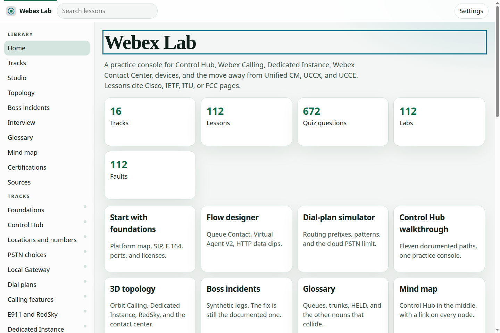
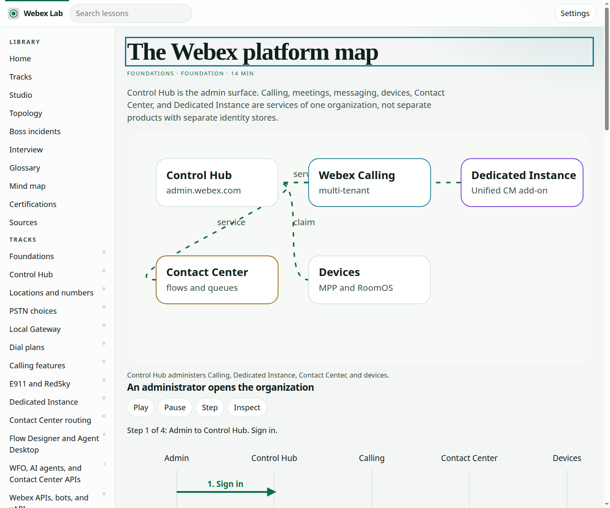
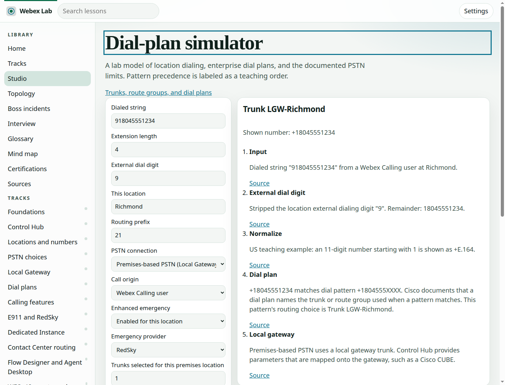
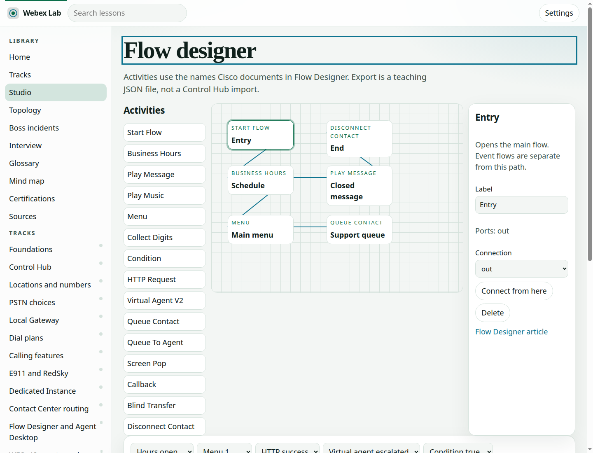
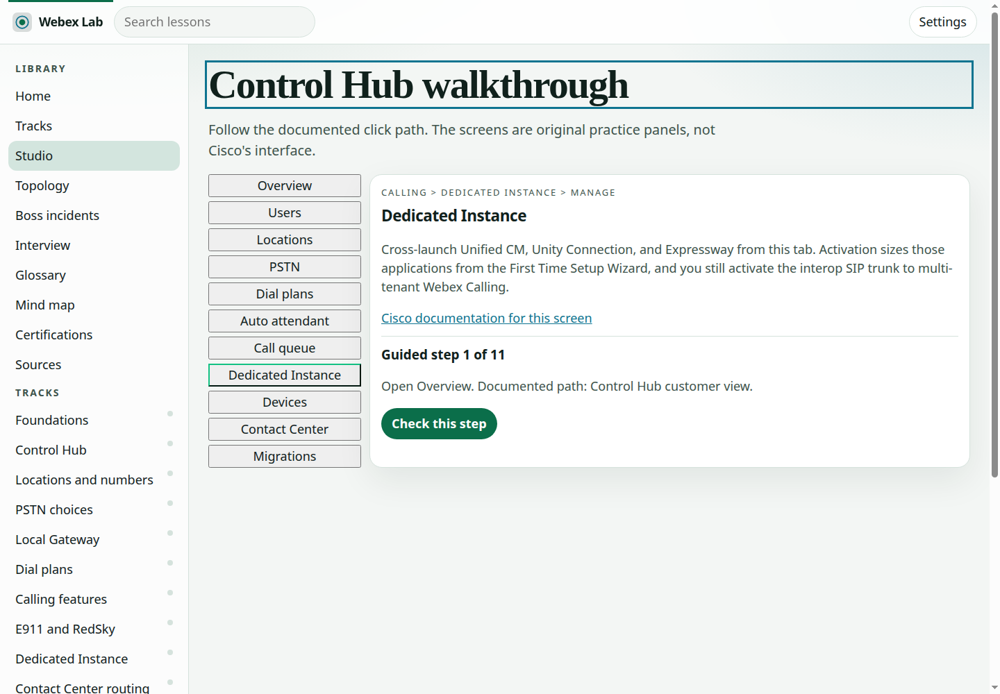
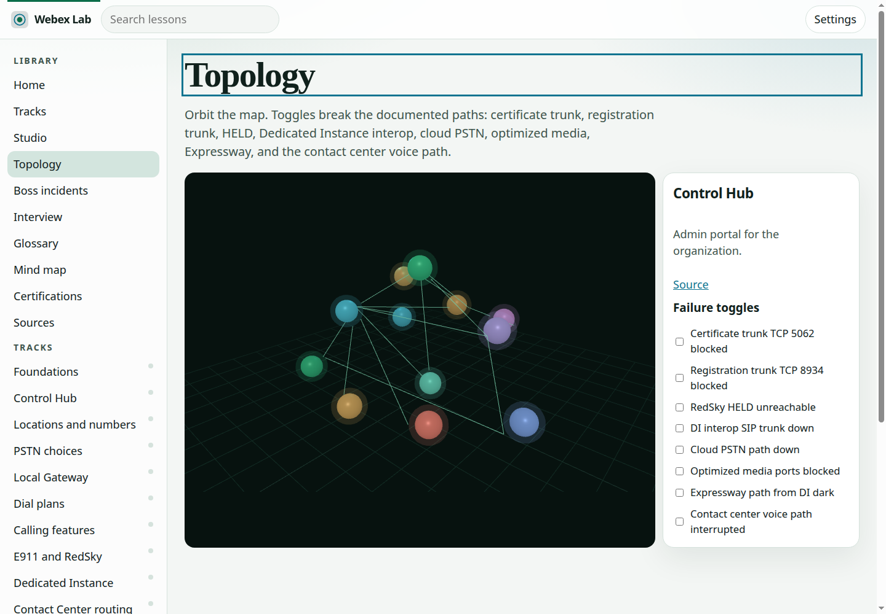

# Webex Lab

A free, static study console for Cisco Webex Control Hub, Webex Calling, Dedicated Instance, Webex Contact Center, devices, APIs, and migration from Unified CM, UCCX, and UCCE.

Lessons cite Cisco help, Cisco developer docs, IETF RFCs, the ITU-T E.164 recommendation, or the FCC MLTS page. The dial-plan simulator, flow canvas, Control Hub walkthrough, and topology are teaching models. They do not change a live tenant and they do not import into Control Hub.

## Run it

From the repository root:

```bash
npm run build:content
npm run verify
npm start
```

`npm start` serves the repository on port 8741. Open [http://127.0.0.1:8741/campus/](http://127.0.0.1:8741/campus/). The root URL redirects there, which is the layout GitHub Pages can publish.

No API key is required. Nothing in the lab calls Webex.

## What you can practice

- Sixteen tracks and 112 lessons, from the platform map through migration and a capstone.
- A lesson player with a diagram, a Play / Pause / Step / Inspect ladder, a quiz, flashcards, a lab checklist, and a synthetic fault.
- A flow designer (`#/studio/flow`) using Flow Designer activity names. Export is schema `webex-lab-flow-1` and is not a Control Hub import.
- A dial-plan simulator (`#/studio/dial`) for extensions, routing prefixes, patterns, 911 and 933, premises-to-cloud PSTN blocking, and the one-trunk warning.
- A Control Hub-style walkthrough (`#/studio/hub`) of eleven documented paths.
- A 3D topology (`#/topology`) with failure toggles. Reduced motion, or a missing WebGL context, uses the same toggles on a flat map. three.js is vendored and loads only on that route.
- Boss incidents, an interview desk, a glossary, a mind map, and a certification page that does not memorize exam prices.

## Counts

`npm run verify` checks the floor: 16 tracks, at least 100 lessons, 600 quiz questions, 20 labs, and 30 faults. The current build is 112 lessons, 672 quiz questions, 112 labs, 112 faults, 8 boss incidents, 38 interview answers, and 45 glossary terms.

The first load (HTML, CSS, the shell scripts, and the small JSON indexes) is about 172 KB. Track JSON and three.js load later. A mobile Lighthouse run of the campus shell scored 98 for performance and 100 for accessibility.

## Screens













## Settings

Lumen, Orbit, high contrast, and Aurora. Sound, narration with a voice picker, speed, reduced motion, and font size persist in `localStorage` under `webexlab.settings`. Narration waits for `voiceschanged` and avoids robotic Microsoft voices when a better voice is installed. A service worker caches the shell; **Save all tracks for offline** fetches every track.

## License

MIT for the code. CC BY 4.0 for the lesson content. three.js r170 is vendored under its own MIT license in `campus/vendor/three/LICENSE`.

Cisco product names belong to Cisco. This lab is not a Cisco product.
